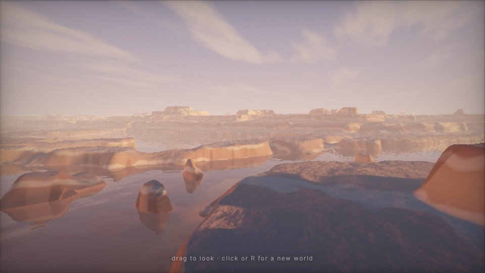
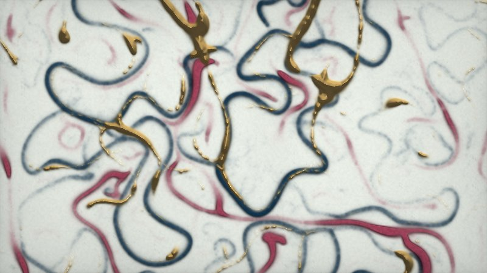
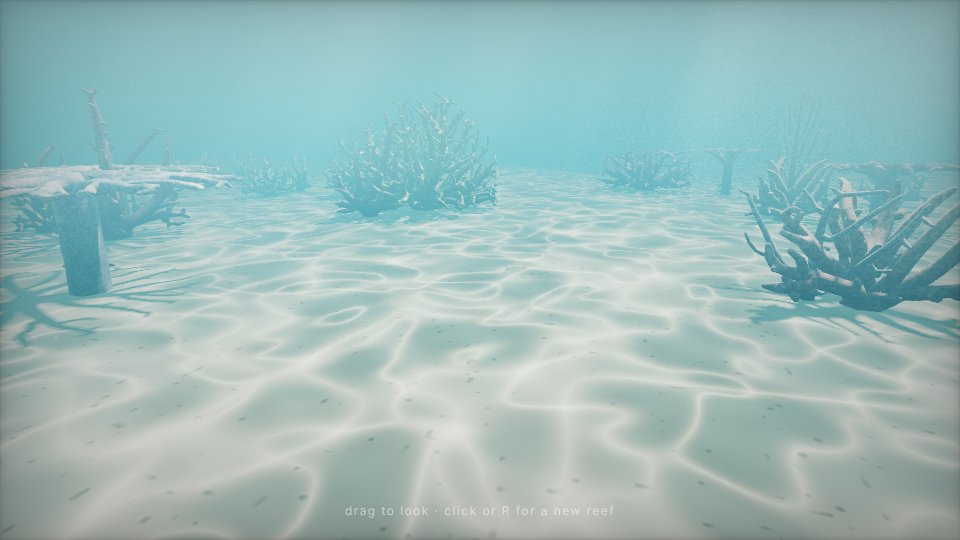
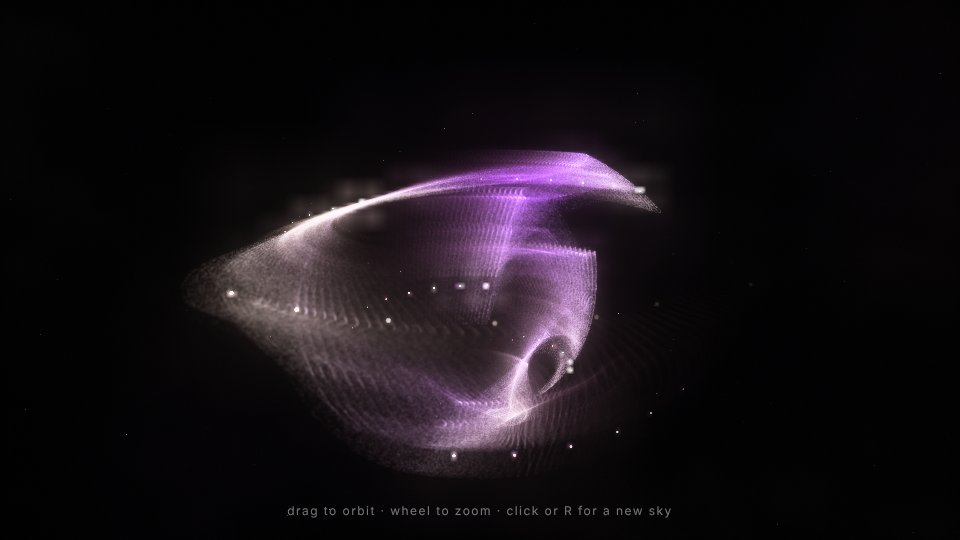

# Procedural worlds: four small WebGL2 pieces

Four self-contained HTML files. Each is a real-time WebGL2 world in the spirit of demoscene
procedural pieces. None of them has an objective: you just watch, or drift around. Open a
file directly in a desktop browser. There's no build step, no server, no libraries and no
assets. Every shape, texture, colour and movement is generated by code when the page loads.
All four files are between 13 and 20 KB.

| piece | foundation | mood | size |
|---|---|---|---|
| [Strata](strata.html) | raymarched signed-distance heightfield: domain-warped, slope-damped fractal noise, then terraced | vast and slow: a dusk flight over flooded mesa country | 13 KB |
| [Ink Mould](ink-mould.html) | GPU agent simulation (Physarum slime mould), three species that interact | intimate and teeming: ink trails on handmade paper | 13 KB |
| [Reef](reef.html) | space-colonisation growth with pipe-model branch thickness | close and calm: gliding over a seabed while coral grows | 20 KB |
| [Strange Dust](strange-dust.html) | a chaotic 3D quadratic map found by automated search, with 0.5M particles | cosmic: luminous folded veils in deep space | 16 KB |

Published (after merge to `main`):
<https://drquicksilver.github.io/Research/procedural-worlds/strata.html>,
[ink-mould.html](https://drquicksilver.github.io/Research/procedural-worlds/ink-mould.html),
[reef.html](https://drquicksilver.github.io/Research/procedural-worlds/reef.html),
[strange-dust.html](https://drquicksilver.github.io/Research/procedural-worlds/strange-dust.html).

*(These stills were rendered by headless software GL. Real GPUs render at full resolution
with live motion.)*

## What the four pieces share

- **Seeds.** Every reload, click or press of `R` makes a new world. The seed goes into the
  URL hash (`strata.html#123456`), so you can share or revisit a world.
- **They never visibly loop.** Strata and Reef travel forward forever through
  generated space. Ink Mould's parameters drift on slow sine clocks whose frequencies don't
  divide into each other, so its pattern regime keeps changing. Strange Dust slowly varies its
  coefficients and moves to a newly discovered attractor every minute or so.
- **Minimal interface.** A one-line hint fades out after 5 seconds. Dragging looks around or
  orbits; the mouse disturbs the slime mould.
- **Robustness.** If WebGL2 (or float render targets, where needed) isn't available, the
  page shows a plain message instead. All four handle resizing and high-DPI screens (device
  pixel ratio capped at 2). Each adapts its cost to frame time: Strata changes its render
  scale, Ink Mould its simulation steps per frame, and Strange Dust its particle count.
- Each file starts with a comment describing the concept, the techniques and the controls.

## The pieces

### Strata — `strata.html`
One fragment shader raymarches the terrain. The heightfield uses integer-hashed value noise
with analytic derivatives:

1. The low octaves are domain-warped.
2. Their contribution is damped where the accumulated slope is steep, which works as a cheap
   erosion.
3. The result is quantised with a soft step, which breaks the land into mesas, buttes and
   benches.
4. The high octaves are added after terracing, so cliff faces and tabletops get their own
   rubble.

Rock colour comes from height bands with noise in them (sediment layers), plus
desert-varnish streaks on steep faces and dust on flat ground.

Lighting and post-processing:
- a low sun with soft raymarched shadows
- sky and bounce ambient light
- drifting cloud shadows
- analytic height fog that picks up the sun's colour
- a sky with sheared cirrus clouds
- still floodwater that runs its own short reflection march
- ACES tone mapping and a split-tone grade

The sun slowly moves between dusk and afternoon. A CPU copy of the low-octave terrain steers
the camera: it heads toward lower ground, climbs quickly and descends slowly, so the flight
runs through canyons and along the water.
Controls: drag to look; click or `R` for a new world.

### Ink Mould — `ink-mould.html`
Hundreds of thousands of agents (about 0.5 per simulation pixel) each follow one rule:
sense ahead-left, ahead and ahead-right, turn toward the strongest scent, step forward, and
deposit ink.

- **Agents** are stored in an RGBA32F texture and updated by a fragment shader.
- **Deposit:** each agent is drawn as a 1-pixel point with additive blending into an RGBA16F
  trail map, one channel per species. The trail map is then blurred and evaporated.
- **Species interaction:** each species senses a weighted mix of all three channels, so
  colonies attract, avoid or chase one another. Those weights drift too.
- **Emergent forms:** cells, membranes, travelling worms, veins and fronts. Nobody wrote any
  of them.
- **Space:** the world is a torus, and the view pans across it without a seam.
- **Display:** subtractive ink layers over procedural fibrous paper, with darker rims where
  ink pools. One channel may be shaded as embossed metal leaf, lit by a lamp that moves.

Controls: move the mouse to shoo the mould; click or `R` for a new culture. Initial cultures
are scattered, an inward-facing disc, loose rings, or separate colonies.

### Reef — `reef.html`
Each coral colony starts as just a cloud of "food" points inside a rough envelope, plus one
root on the sand. The envelope shapes are a staghorn ellipsoid, a sea-fan disc, a table
(stem plus plate), pillar clumps, and a sunburst shell.

The branching comes from space colonisation: growing tips compete for the food points. Each
colony has its own spatial hash, and the algorithm uses influence and kill radii, an upward
pull, and a guard against duplicate nodes. The branches thicken by the pipe model: each node
counts its descendants, and radius grows with that count.

The algorithm runs in JS against a 5 ms per-frame budget, and nodes stream into float
textures. Each node is drawn as one instance of a tapered capsule that the vertex shader
generates from `gl_VertexID`. The vertex shader also animates new segments sprouting.

Lighting and post-processing:
- an orthographic sun shadow map with hardware PCF
- animated ridged-noise caustics projected along the light
- ambient light tinted by the water colour, rim light, and a polyp texture
- 4× MSAA into a half-float target whose alpha channel holds view distance
- a post pass for depth fog that brightens toward the surface, raymarched light shafts and
  tone mapping
- drifting marine snow

Colonies seed in patches ahead of you and grow as they come out of the fog.
Controls: drag to look; click or `R` for a new reef.

### Strange Dust — `strange-dust.html`
The CPU tries random 30-coefficient quadratic 3D maps, following Sprott's method. It rejects
an orbit if:
- it escapes or collapses;
- its Lyapunov exponent isn't clearly positive;
- it is too flat;
- its correlation dimension is outside about 1.3–2.5.

From the map that passes, it builds an orbit texture.

On the GPU, 524k particles each take one step of the map per frame. They are drawn as
additive points into a half-float buffer. The buffer decays rather than clearing, so it
integrates millions of samples into a smooth density.

How the image is built:
- **Colour** comes from each mote's local step length and direction.
- **Depth of field:** points grow with distance from the focal plane, and their brightness
  drops to keep total energy the same.
- **Bloom** comes from the buffer's mip chain.
- **Auto-exposure** uses a density-weighted mean brightness, so both sparse and very dense
  attractors are exposed well.
- **Background:** a faint procedural nebula and a star field.

New attractors arrive by migration: particles switch to the new map gradually, and each one
fades in from the new orbit.
Controls: drag to orbit; wheel to zoom; click or `R` for a new sky.

## How it was tested, and its limits

`shot.js` is a small Playwright script. It drives each page in headless Chromium with
SwiftShader (software GL), replacing `requestAnimationFrame` with a manual stepper so slow
software frames can still be captured. It also collects console errors. All four pieces
compile and render with no errors there, and the screenshots above come from it.
Two test-only query parameters make that practical: `strata.html?s=0.6` fixes the render
scale, and `reef.html?w=70` pre-grows 70 seconds of reef.

**Not tested: real GPU hardware.** Everything was tuned from software-rendered stills, so
**frame rate on an actual laptop GPU has not been measured**. The adaptive controls are there
for that reason. Reef is the heaviest: it can reach tens of thousands of instanced capsules,
and each is drawn twice (once for shadows). Animation and motion quality, such as how the
growth and the drifting look over minutes, were checked only through a few stills at
different times.

See [notes.md](notes.md) for the working log: what went wrong on first renders and how each
piece was tuned.
