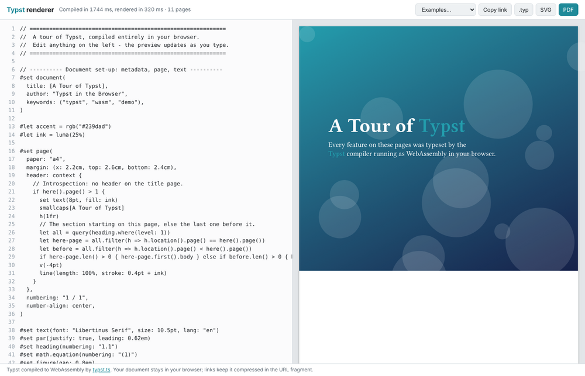
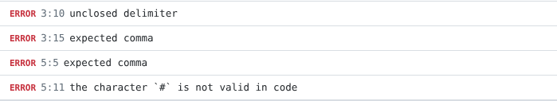
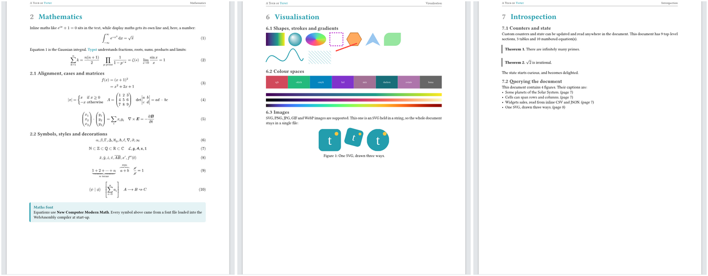

# Rendering Typst entirely in the browser

**Yes, you can.** [**Open the Typst renderer →**](typst.html)
(published at https://drquicksilver.github.io/Research/typst-client-side/typst.html once merged)

Simon Willison's [LaTeX renderer](https://simonwillison.net/2026/Oct/15/latex/) (15 Oct 2026) is a
single HTML page that typesets LaTeX with a WebAssembly engine (faster-latex), keeps the document in a
compressed URL fragment, and shows the output in a sandboxed iframe. This project does the same for
[Typst](https://typst.app). It opens with an 11-page tour of Typst's features.

## How it works

Typst is written in Rust, so the real compiler builds to WebAssembly. The
[typst.ts](https://github.com/Myriad-Dreamin/typst.ts) project publishes it on npm, and the page
loads it from jsDelivr. There is no server.

| Piece | Source | Size (over the network) |
|---|---|---|
| JS glue: `@myriaddreamin/typst.ts@0.7.0` `all-in-one-lite.bundle.js` | jsDelivr | 0.2 MB (tiny compressed) |
| Compiler (Typst 0.14): `@myriaddreamin/typst-ts-web-compiler@0.7.0` | jsDelivr | 28 MB (7.2 MB brotli) |
| SVG renderer: `@myriaddreamin/typst-ts-renderer@0.7.0` | jsDelivr | 1 MB (0.3 MB) |
| Fonts: Libertinus Serif, New Computer Modern (+ Math), DejaVu Sans Mono from `typst/typst-assets@v0.14.2` | jsDelivr (GitHub) | 8.8 MB (5.8 MB) |
| URL compression: pako 2.1.0 | cdnjs | small |

So the first visit downloads about 13 MB, and later visits load it from the browser cache. Then:

1. The source goes into the compiler's virtual file system (`/main.typ`). It compiles to typst.ts's
   "vector" format, along with full diagnostics.
2. The renderer turns that into one SVG. The page puts it into an iframe with
   `sandbox="allow-same-origin allow-popups…"` and **no `allow-scripts`**. It gives each page a white
   sheet and a gap, and the scroll position survives re-renders.
3. **PDF** export runs the same compiler with the PDF target. **SVG** and **.typ** downloads are also
   available.
4. Every edit is saved to the URL as `#z=<base64url(raw deflate)>`. The deflate uses a preset
   dictionary of common Typst fragments, the same trick Simon used for LaTeX. **Copy link** shares
   the document; `#src=<url-encoded text>` also works for hand-written links.
5. `#import "@preview/…"` packages download on demand from packages.typst.org as tarballs, which
   the WASM compiler unpacks.

Errors and warnings appear under the editor with line:column; click one to jump to it.

## The feature tour

[`demo.typ`](demo.typ) is built into the page (by `inline_demo.py`). Everything in it, including the
data, the bibliography and the image, is inline, so a link carries the whole document. It covers:

- **Document set-up**: metadata, page size and margins, a running header that uses introspection,
  page numbering, a full-bleed title page, an outline
- **Markup**: emphasis, raw, links, footnotes, smart quotes, escapes, the three list types,
  labels and references, block quotes, and `eval` showing source beside its result
- **Maths**: inline and numbered display maths, alignment, `cases`, matrices, vectors, symbol
  sets, accents, braces, `cancel`, `lr` delimiters
- **Code and scripting**: syntax-highlighted raw blocks, functions, recursion, closures, arrays,
  dictionaries, destructuring, regex, `calc`, loops that produce content, show rules that use regex
  and text replacement
- **Layout**: grid, stack, rotate/scale/skew, columns with `colbreak`, `place`, `measure`, `layout`
- **Tables and figures**: header rows, stroke and fill functions, `hline`, colspan and rowspan,
  numbered captions
- **Data**: CSV and JSON parsed into a table and a bar chart
- **Visualisation**: rect, circle, ellipse, polygons, Bézier `curve`, dashed strokes, linear,
  radial and conic gradients, colour maps, `tiling`, rgb/oklch/cmyk/hsl colours, colour mixing,
  inline SVG images
- **Introspection**: counters, custom theorem counters, `state`, `query` over figures
- **Bibliography**: BibTeX, `@cite` and prose citations, IEEE style
- **Typography**: font families, weights, OpenType features (old-style numbers, fractions,
  tracking, ligatures), hyphenation in English, German and French, paragraph indents

The **Examples** menu also has a hello-world, a maths sheet and a package example.

## Performance

These numbers come from headless Chromium on this sandbox:

- First compile of the 11-page tour: about 1.8 s, then about 0.4 s to render the SVG.
- After an edit: 170–470 ms to recompile (incremental), plus about 200 ms to render.

Compiling runs on the main thread, so typing can stutter for a moment on large documents. Moving the
compiler into a Web Worker would fix this; it is a possible next step.

## Caveats

- The page needs network access to jsDelivr (and cdnjs) on the first load.
- Only the default Typst fonts are bundled: no emoji or CJK fonts. Adding them is one more
  `FONTS` entry each, but the emoji font alone is 13 MB.
- My sandbox could not reach jsDelivr or packages.typst.org. All browser testing used the
  **identical npm and GitHub files** served locally through Playwright request interception. The
  package import was tested against a tarball rebuilt from `typst/packages`, so a real-world CORS
  problem on packages.typst.org would only affect `@preview` imports.

## Files

- [`typst.html`](typst.html): the tool, a single self-contained page
- [`demo.typ`](demo.typ): the source of the feature tour
- [`inline_demo.py`](inline_demo.py): copies `demo.typ` into `typst.html`
- [`test/browser-test.mjs`](test/browser-test.mjs): Playwright end-to-end test (instructions inside)
- [`notes.md`](notes.md): working notes, dead ends and measurements
- `screenshots/`: screenshots from the test run
